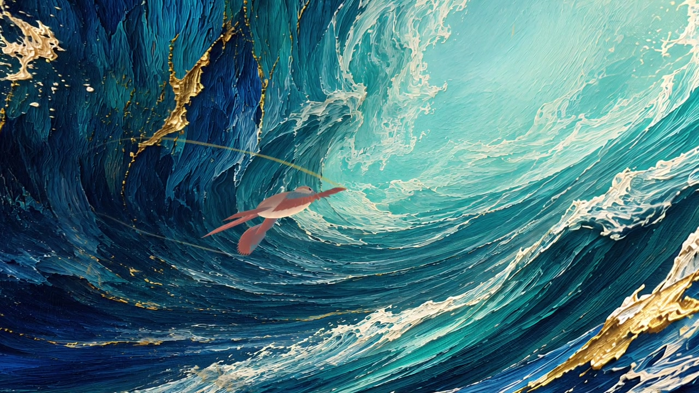

# Riptide · The Sun, Again

A swallow flies through three paintings. Five woodcut gates open, 22 hinged pages carry prints of its wings, and the bird banks through an ink fissure into a curling wave. A 26.5-second browser film by **Andy Woohoo**, made with Codex, ImageGen and Three.js.

[Play the scene](https://andy-huang-szu.github.io/riptide-flight/) · [Read the illustrated making-of in English or 中文](https://andy-huang-szu.github.io/riptide-flight/making-of.html) · [Watch the 1080p60 film](https://andy-huang-szu.github.io/riptide-flight/docs/riptide.mp4)

[](https://andy-huang-szu.github.io/riptide-flight/?t=17.171)

## Explore a shot

- **10.53 s.** The animated swallow supplies four wing poses for an offscreen ink atlas. The hinged pages sample that atlas as they turn. [Watch the print sequence](https://andy-huang-szu.github.io/riptide-flight/?t=10.531) · [Stamp code](src/stamps.js)
- **14.78 s.** Three mesh landmarks define the beak-to-tail axis. Align it to the path tangent, then bank and fold the wings to clear the slit. [Inspect the fissure](https://andy-huang-szu.github.io/riptide-flight/?t=14.781) · [Flight rig](src/flight.js)
- **17.17 s.** Radius around the painted eye sets the mesh depth. The texture coordinates travel with their vertices as the lip rolls and peels. [Enter the wave](https://andy-huang-szu.github.io/riptide-flight/?t=17.171) · [Wave shader](src/tide.js)

## Run locally

Download or clone the repo, start the server from its root, then open localhost on port 8000 in a WebGL 2 browser.

```sh
python3 -m http.server 8000
```

A single-file edition runs offline. Download it from the release, or build it with Python's standard library.

```sh
python3 build.py --standalone
```

Open `riptide-offline.html`. The web player chooses display-size textures for smaller screens. Append `?quality=master` to load all three 6688 × 3764 maps. Use `?t=14.781` to share a playhead position. In the browser console, `seek(1030 / 60)` draws frame 1030.

## How it was made

| Stage | What you can inspect or edit |
| --- | --- |
| Paint | Three lossless original paintings, twelve overlapping ImageGen repaints and the crop bounds. The registration pass fits SIFT matches, refines alignment with optical flow and feathers the detail into the master. [Original prompts](docs/painting-prompts.md) · [Detail prompts and art](assets/detail-paint/production.md) · [Registration](tools/assemble_art.py) |
| Build the set | The same sky painting feeds three moving leaves. Five gates have three blocks each. Eleven independent leaves flank each side of the path. The wave uses a 205 × 127 grid. [Opening](src/paper.js) · [Gates and leaves](src/printworks.js) · [Wave](src/tide.js) |
| Animate | A seven-bone swallow, measured forward axis, a deterministic wing cycle, and a camera sampled from the same time as the set. [Editable Blender file](tools/studio-swallow.blend) · [Rig and pose](src/flight.js) · [Camera and scene](src/film.js) |
| Score and render | A 127 BPM grid with 56 beats and 17 action cues. Four samples across a 72° shutter for each of 1,590 frames. WebCodecs encodes H.264. FFmpeg muxes the 48 kHz stereo mix. [Beat grid](beat-grid.json) · [Frame export](src/export.js) · [Procedural score](tools/score.py) |
| Make the breakdown | The six sheets use real film crops, a diagnostic shader, projected rig joints and music measurements. The opening cutaway is an ImageGen illustration. [Reader source](making-of-src) · [Cutaway prompt](making-of-src/imagegen-prompt.md) · [PNGs and offline film](https://github.com/Andy-Huang-SZU/riptide-flight/releases/tag/v1.0.0) |

The projection technique was inspired by Max Vedel’s *Paris Freestyle*. [Original post](https://x.com/mxvdl/status/2120505286603505858)

## Render or remix

The public scene keeps the choreography, camera, painted set and shaders from the studio cut. It ships with our own procedural swallow, its editable Blender rig and a synthesized score on the original cue grid. The stills in the illustrated guide document the studio cut, which used a Tripo H3.1 mesh rigged in Blender and a Suno recording. [Credits and asset terms](CREDITS.md)

To render with Chrome and FFmpeg installed, install Playwright for Python and run the exporter. Set `CHROME_PATH` if the browser is outside the usual locations. The render reads the embedded assets in `riptide-offline.html`; rebuild that file after changing source or artwork.

```sh
python3 -m pip install playwright
python3 build.py --standalone
python3 tools/export_movie.py --height 2160 --out riptide.mp4
```

To regenerate the illustrated guide and print sheets, install Pillow and Playwright and use the same Chrome binary. The guide also supports a Chinese export with `--lang zh`.

```sh
python3 making-of-src/build_poster.py
python3 -m pip install Pillow playwright
python3 making-of-src/export_plates.py --out exports
```
